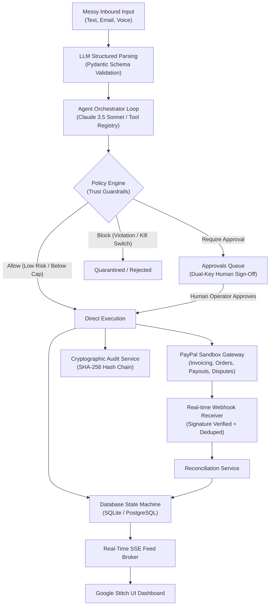

# Architecture & Security Blueprint (`docs/ARCHITECTURE.md`)

## 1. System Overview

Collections Copilot is an autonomous financial agent that gets freelancers and small businesses paid on time.
The architecture enforces a strict principle: **The model proposes. Code decides.**

---

## 2. The Policy Engine (Invariant Guardrails)

The Policy Engine serves as an air-gap between probabilistic LLM generation and real transactional money movement.

| Action | Risk Tier | Default Policy Rule |
| :--- | :--- | :--- |
| `lookup_client`, `get_invoice`, `cash_flow` | `read` | Always permitted. Zero money impact. |
| `create_invoice_draft` | `low` | Permitted. Draft status does not bill client. |
| `send_invoice` | `medium` | Auto-dispatch if total <= $250. Escalates to human approval if > $250 or new client. |
| `send_reminder` | `low` | Auto if > 3 days since last reminder, not in quiet hours, and no open dispute. |
| `propose_payout` | `high` | Strict limits: max $500/tx, max $1,500/day, approved contractor allowlist only. |
| `cancel_invoice`, `accept_dispute` | `high` | Always requires human confirmation. Never automated. |

---

## 3. Cryptographic Tamper-Evident Audit Chain

Every action, policy evaluation, approval, and PayPal API call is cryptographically appended to the audit ledger:

$$H_n = \text{SHA256}(H_{n-1} + \text{canonical\_json}(R_n))$$

- **Genesis Block**: Seeded with a 64-character null root hash.
- **Verification Endpoint**: `GET /audit/verify` iterates through all entries, re-computes every SHA-256 hash in sequence, and validates that no historical payload or sequence number has been altered.

---

## 4. Time Travel & Simulation Service

All application services read the current time via `ClockService.now()`.
This enables instantaneous time travel during live hackathon judging:
- `POST /simulate/time-travel { "days": 15 }`
- Instantly triggers overdue scanning, flips unpaid invoices into overdue status, updates aging buckets, and adapts the reminder tone ladder without waiting on real calendar time.

